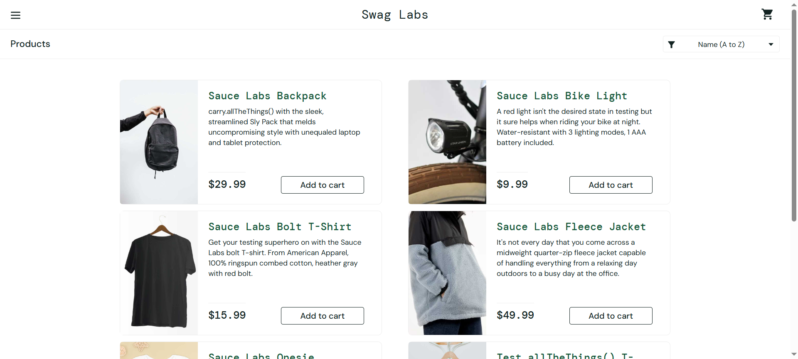
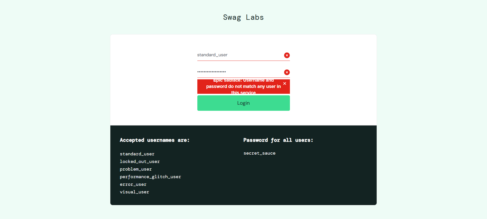
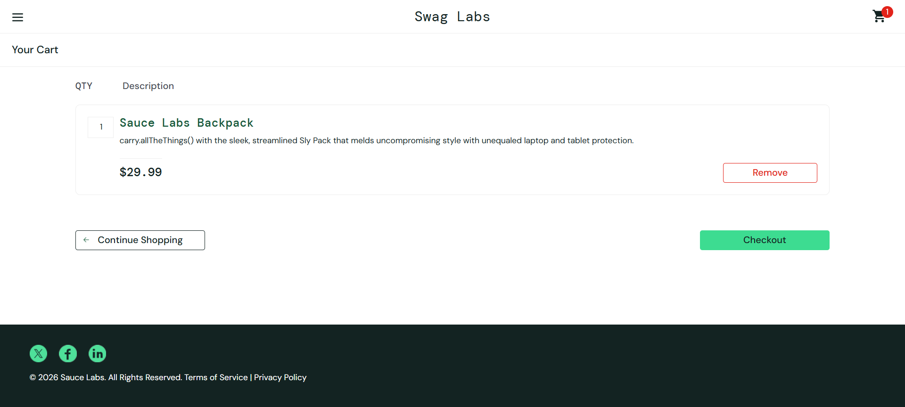
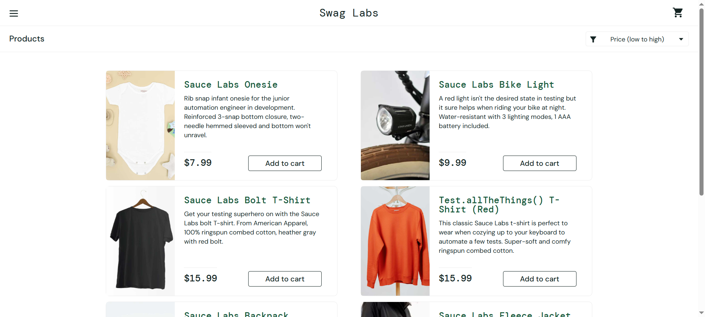
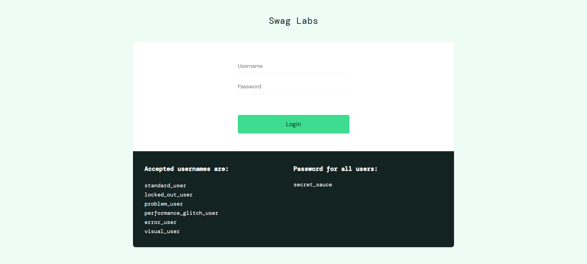
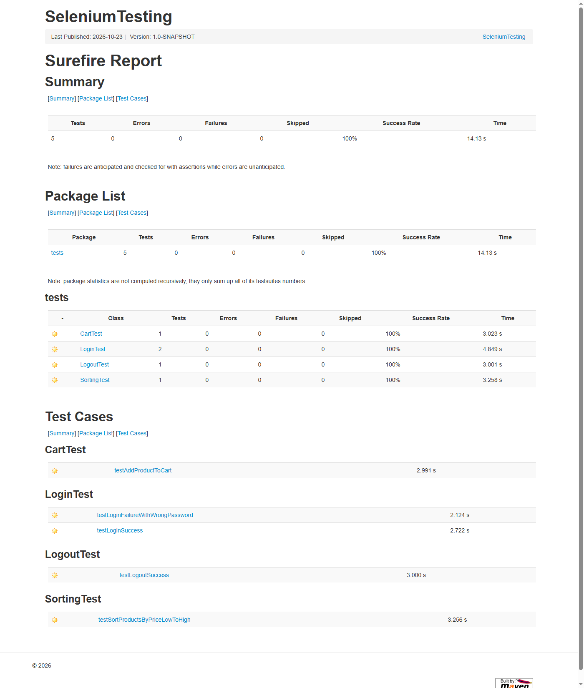

# BÁO CÁO BÀI TẬP THỰC HÀNH: KIỂM THỬ TỰ ĐỘNG WEBSITE BẰNG SELENIUM WEBDRIVER

---

## 1. Tên đề tài
**Kiểm thử tự động website thương mại điện tử SauceDemo bằng công cụ Selenium WebDriver, JUnit 5 và Maven trên ngôn ngữ Java.**

---

## 2. Giới thiệu và mục tiêu

### 2.1. Giới thiệu
Kiểm thử tự động (Automation Testing) đóng vai trò quan trọng trong quy trình đảm bảo chất lượng phần mềm (Software Quality Assurance), giúp rút ngắn thời gian kiểm thử hồi quy, giảm thiểu sai sót do thao tác thủ công của con người và nâng cao độ tin cậy của hệ thống.

**Selenium WebDriver** là bộ công cụ mã nguồn mở phổ biến hàng đầu hiện nay dùng để tự động hóa các thao tác trên trình duyệt web thông qua giao thức chuẩn W3C WebDriver. Kết hợp với **JUnit 5 (JUnit Jupiter)** và công cụ quản lý dự án **Apache Maven**, lập trình viên và kiểm thử viên có thể xây dựng các bộ kịch bản kiểm thử (test suite) độc lập, có cấu trúc rõ ràng và dễ dàng tái sử dụng.

### 2.2. Mục tiêu bài thực hành
- Tự nghiên cứu và làm chủ quy trình thiết lập dự án kiểm thử tự động bằng **Java + Maven + Selenium WebDriver + JUnit 5**.
- Nắm vững cách xác định phần tử web (WebElement Locators) bằng `id`, `className`, `cssSelector`.
- Áp dụng cơ chế chờ tường minh (**Explicit Wait** — `WebDriverWait` & `ExpectedConditions`) thay cho `Thread.sleep()` để đồng bộ hóa tốc độ kịch bản với quá trình tải trang thực tế.
- Xây dựng và thực thi thành công tối thiểu **05 kịch bản kiểm thử tự động (Test Cases)** độc lập cho các luồng nghiệp vụ cốt lõi trên website thương mại điện tử mẫu.
- Thu thập bằng chứng kiểm thử thực tế (ảnh chụp màn hình trình duyệt, báo cáo Maven Surefire) và trình bày báo cáo kỹ thuật hoàn chỉnh.

---

## 3. Phạm vi kiểm thử

### 3.1. Các chức năng trong phạm vi kiểm thử (In-Scope)
Bài thực hành tập trung kiểm thử tự động giao diện người dùng (UI Functional Testing) cho 04 nhóm chức năng chính của website **SauceDemo**:
1. **Xác thực người dùng (Authentication - Login):**
   - Đăng nhập hợp lệ với tài khoản chuẩn (`standard_user`).
   - Xử lý thông báo lỗi khi đăng nhập sai mật khẩu.
2. **Quản lý giỏ hàng (Shopping Cart):**
   - Thêm sản phẩm từ danh mục vào giỏ hàng, kiểm tra số lượng hiển thị trên biểu tượng giỏ hàng và thông tin chi tiết sản phẩm bên trong giỏ hàng.
3. **Sắp xếp danh sách sản phẩm (Product Sorting):**
   - Lọc và sắp xếp sản phẩm theo tiêu chí giá tăng dần (`Price (low to high)`), đối chiếu thứ tự giá hiển thị trên giao diện.
4. **Đăng xuất hệ thống (Logout):**
   - Mở thanh menu điều hướng bên trái (Burger Menu), thực hiện đăng xuất và xác minh điều hướng quay về trang đăng nhập.

### 3.2. Các hạng mục ngoài phạm vi (Out-of-Scope)
- Kiểm thử hiệu năng (Performance/Load Testing) và kiểm thử bảo mật (Security Testing).
- Kiểm thử đa trình duyệt (chỉ thực thi trên trình duyệt **Google Chrome** theo đúng cấu hình môi trường thực tế).

---

## 4. Website và môi trường kiểm thử

### 4.1. Website kiểm thử (System Under Test - SUT)
- **URL chính thức:** [https://www.saucedemo.com/](https://www.saucedemo.com/)
- **Mô tả:** Website thương mại điện tử demo **Swag Labs** do Sauce Labs cung cấp chính thức để phục vụ học tập và thực hành kiểm thử tự động.
- **Tài khoản kiểm thử hợp lệ:**
  - **Username:** `standard_user`
  - **Password:** `secret_sauce`

### 4.2. Môi trường thực thi thực tế
| Thành phần | Thông số cấu hình |
|---|---|
| **Hệ điều hành** | Windows 10 (64-bit, `amd64`) |
| **Java Development Kit (JDK)** | Java JDK `21.0.11` LTS (Cấu hình biên dịch Maven `<maven.compiler.release>20</maven.compiler.release>` tương thích JDK 20+) |
| **Công cụ quản lý build** | Apache Maven `3.9.16` |
| **IDE phát triển** | IntelliJ IDEA |
| **Trình duyệt kiểm thử** | Google Chrome `155.0.8059.85` |
| **Cơ chế quản lý Driver** | Selenium Manager (tích hợp sẵn trong Selenium 4.27.0, tự động tải và cấu hình `chromedriver` tương thích) |

---

## 5. Công cụ, thư viện sử dụng

Các thư viện và plugin được khai báo trong file [`pom.xml`](pom.xml):

| Thư viện / Plugin | GroupId : ArtifactId | Phiên bản | Vai trò trong dự án |
|---|---|---|---|
| **Selenium Java** | `org.seleniumhq.selenium:selenium-java` | `4.27.0` | Cung cấp API điều khiển trình duyệt Chrome (`ChromeDriver`, `WebDriverWait`, `Select`, `TakesScreenshot`) và tự động quản lý WebDriver qua Selenium Manager. |
| **JUnit 5 (Jupiter)** | `org.junit.jupiter:junit-jupiter` | `5.11.4` | Framework quản lý vòng đời kiểm thử (`@BeforeEach`, `@AfterEach`, `@Test`, `@DisplayName`) và cung cấp các phương thức xác minh (`Assertions`). |
| **Maven Surefire Plugin** | `org.apache.maven.plugins:maven-surefire-plugin` | `3.5.2` | Thực thi bộ test JUnit 5 từ dòng lệnh Maven và xuất báo cáo kết quả kiểm thử tại `target/surefire-reports/`. |

---

## 6. Cấu trúc thư mục

Dự án được tổ chức theo chuẩn Maven tiêu chuẩn, tách biệt rõ ràng giữa mã nguồn kiểm thử, ảnh minh chứng và tài liệu mô tả:

```text
SeleniumTesting/
├── pom.xml                                 # Khai báo phụ thuộc Selenium, JUnit 5 và cấu hình Maven
├── README.md                               # Báo cáo tổng hợp bài tập thực hành Selenium
├── .gitignore                              # Danh sách các file/thư mục bỏ qua khi đẩy lên GitHub
├── src/
│   ├── main/
│   │   └── java/org/example/Main.java      # Lớp mặc định khi khởi tạo project
│   └── test/
│       └── java/
│           └── tests/
│               ├── BaseTest.java           # Lớp cơ sở khởi tạo ChromeDriver, Explicit Wait, Login & Screenshot
│               ├── LoginTest.java          # Chứa TC01 (Đăng nhập thành công) & TC02 (Đăng nhập sai mật khẩu)
│               ├── CartTest.java           # Chứa TC03 (Thêm sản phẩm vào giỏ hàng)
│               ├── SortingTest.java        # Chứa TC04 (Sắp xếp sản phẩm theo giá tăng dần)
│               └── LogoutTest.java         # Chứa TC05 (Đăng xuất khỏi hệ thống)
├── screenshots/
│   ├── test-01-login-success.png           # Ảnh minh chứng TC01 (chụp tự động từ trình duyệt)
│   ├── test-02-login-failure.png           # Ảnh minh chứng TC02 (chụp tự động từ trình duyệt)
│   ├── test-03-cart.png                    # Ảnh minh chứng TC03 (chụp tự động từ trình duyệt)
│   ├── test-04-sorting.png                 # Ảnh minh chứng TC04 (chụp tự động từ trình duyệt)
│   ├── test-05-logout.png                  # Ảnh minh chứng TC05 (chụp tự động từ trình duyệt)
│   └── test-results.png                    # Ảnh minh chứng tổng kết kết quả chạy 5 test case
└── docs/
    └── TEST_CASES.md                       # Tài liệu đặc tả kịch bản kiểm thử chi tiết
```

---

## 7. Danh sách 05 Test Case kiểm thử tự động

Chi tiết tài liệu kịch bản kiểm thử cũng được lưu trữ tại [`docs/TEST_CASES.md`](docs/TEST_CASES.md).

### 7.1. Bảng tổng hợp 05 Test Case

| Mã TC | Tên Test Case | Tiền điều kiện | Các bước thực hiện | Dữ liệu kiểm thử | Kết quả mong đợi | Kết quả thực tế | Trạng thái |
|---|---|---|---|---|---|---|---|
| **TC01** | Đăng nhập thành công với tài khoản hợp lệ (`LoginTest#testLoginSuccess`) | Trình duyệt Chrome mở mới, truy cập được trang chủ SauceDemo. | 1. Mở `https://www.saucedemo.com/`<br>2. Nhập Username hợp lệ<br>3. Nhập Password hợp lệ<br>4. Nhấn nút `Login`<br>5. Kiểm tra URL và tiêu đề trang sản phẩm | - Username: `standard_user`<br>- Password: `secret_sauce` | Đăng nhập thành công; URL chứa `inventory.html` và tiêu đề trang hiển thị là `"Products"`. | Hệ thống chuyển sang `https://www.saucedemo.com/inventory.html`, tiêu đề trang hiển thị đúng `"Products"`. | **Pass** |
| **TC02** | Đăng nhập thất bại khi nhập sai mật khẩu (`LoginTest#testLoginFailureWithWrongPassword`) | Trình duyệt Chrome mở mới, truy cập được trang chủ SauceDemo. | 1. Mở `https://www.saucedemo.com/`<br>2. Nhập Username hợp lệ<br>3. Nhập Password sai<br>4. Nhấn nút `Login`<br>5. Kiểm tra thông báo lỗi và URL hiện tại | - Username: `standard_user`<br>- Password: `wrong_password_123` | Không cho phép đăng nhập; giữ nguyên trang đăng nhập và hiển thị thông báo lỗi `"Epic sadface: Username and password do not match any user in this service"`. | Giữ nguyên tại `https://www.saucedemo.com/`, hiển thị khung báo lỗi màu đỏ với nội dung khớp hoàn toàn. | **Pass** |
| **TC03** | Thêm sản phẩm vào giỏ hàng (`CartTest#testAddProductToCart`) | Đã đăng nhập thành công bằng tài khoản `standard_user`. | 1. Đăng nhập hệ thống<br>2. Nhấn `Add to cart` tại sản phẩm `Sauce Labs Backpack`<br>3. Kiểm tra badge số lượng trên icon giỏ hàng<br>4. Mở giỏ hàng và kiểm tra tên sản phẩm, số lượng | - Username: `standard_user`<br>- Password: `secret_sauce`<br>- Sản phẩm: `Sauce Labs Backpack` | Số lượng trên biểu tượng giỏ hàng bằng `1`; trang giỏ hàng (`cart.html`) hiển thị đúng sản phẩm `"Sauce Labs Backpack"` với số lượng `1`. | Badge giỏ hàng hiển thị `"1"`; trang `cart.html` hiển thị sản phẩm `"Sauce Labs Backpack"` và số lượng `"1"`. | **Pass** |
| **TC04** | Sắp xếp sản phẩm theo giá tăng dần (`SortingTest#testSortProductsByPriceLowToHigh`) | Đã đăng nhập thành công bằng tài khoản `standard_user`. | 1. Đăng nhập hệ thống<br>2. Mở dropdown lọc sản phẩm<br>3. Chọn `Price (low to high)`<br>4. Thu thập danh sách giá các sản phẩm trên giao diện<br>5. Kiểm tra thứ tự tăng dần | - Username: `standard_user`<br>- Password: `secret_sauce`<br>- Bộ lọc: `Price (low to high)` | Danh sách giá sản phẩm hiển thị trên giao diện được sắp xếp theo thứ tự không giảm (tăng dần từ thấp đến cao). | Danh sách 6 mức giá thu được là `[7.99, 9.99, 15.99, 15.99, 29.99, 49.99]`, đúng thứ tự tăng dần. | **Pass** |
| **TC05** | Đăng xuất khỏi hệ thống (`LogoutTest#testLogoutSuccess`) | Đã đăng nhập thành công bằng tài khoản `standard_user`. | 1. Đăng nhập hệ thống<br>2. Nhấn nút menu bên trái (`react-burger-menu-btn`)<br>3. Chờ menu trượt ra và nhấn `Logout`<br>4. Kiểm tra URL và các phần tử trên trang đăng nhập | - Username: `standard_user`<br>- Password: `secret_sauce` | Hệ thống đăng xuất phiên làm việc và quay về trang `https://www.saucedemo.com/`, nút `Login` và ô `Username` hiển thị lại. | Quay về đúng `https://www.saucedemo.com/`, nút `Login` và ô nhập `Username` hiển thị đầy đủ trên màn hình. | **Pass** |

---

## 8. Hướng dẫn cài đặt môi trường

1. **Cài đặt Java JDK (từ JDK 20 trở lên):**
   - Tải và cài đặt JDK 20 hoặc JDK 21 từ trang chủ Oracle hoặc Adoptium.
   - Thiết lập biến môi trường `JAVA_HOME` và kiểm tra bằng lệnh:
     ```bash
     java -version
     ```
2. **Cài đặt Apache Maven:**
   - Cài đặt Apache Maven (3.8+ hoặc sử dụng Maven tích hợp sẵn trong IntelliJ IDEA).
   - Kiểm tra phiên bản bằng lệnh:
     ```bash
     mvn -version
     ```
3. **Cài đặt trình duyệt Google Chrome:**
   - Đảm bảo máy tính đã cài đặt trình duyệt Google Chrome phiên bản ổn định mới nhất.
   - **Lưu ý:** Không cần tải `chromedriver.exe` thủ công vì Selenium 4.27.0 đã tích hợp **Selenium Manager** tự động nhận diện phiên bản Chrome và tải driver tương ứng.

---

## 9. Hướng dẫn mở project bằng IntelliJ IDEA

1. Khởi động **IntelliJ IDEA**.
2. Chọn **File** $\rightarrow$ **Open...** và trỏ tới thư mục gốc của project (`SeleniumTesting`).
3. IntelliJ IDEA sẽ tự động nhận diện file [`pom.xml`](pom.xml) là một Maven Project.
4. Chờ quá trình **Maven Sync / Indexing** tải đầy đủ các thư viện phụ thuộc (`selenium-java`, `junit-jupiter`). Nếu cần tải lại thủ công, mở tab **Maven** ở thanh bên phải và nhấn biểu tượng **Reload All Maven Projects**.
5. Kiểm tra cấu hình JDK của dự án tại **File** $\rightarrow$ **Project Structure...** (`Ctrl + Alt + Shift + S`) $\rightarrow$ mục **Project SDK** chọn **JDK 20** (hoặc JDK 21).

---

## 10. Hướng dẫn chạy từng test case và toàn bộ test suite

### 10.1. Chạy bằng dòng lệnh Maven (Terminal / Command Prompt)

- **Chạy toàn bộ 05 test case (Toàn bộ Test Suite):**
  ```bash
  mvn clean test
  ```
- **Chạy riêng từng lớp kiểm thử (Test Class):**
  ```bash
  # Chạy lớp LoginTest (gồm TC01 và TC02)
  mvn test -Dtest=LoginTest

  # Chạy lớp CartTest (TC03)
  mvn test -Dtest=CartTest

  # Chạy lớp SortingTest (TC04)
  mvn test -Dtest=SortingTest

  # Chạy lớp LogoutTest (TC05)
  mvn test -Dtest=LogoutTest
  ```
- **Chạy riêng lẻ một phương thức kiểm thử cụ thể:**
  ```bash
  mvn test -Dtest=LoginTest#testLoginSuccess
  mvn test -Dtest=LoginTest#testLoginFailureWithWrongPassword
  ```

### 10.2. Chạy trực tiếp trên giao diện IntelliJ IDEA
- **Chạy toàn bộ test suite:** Trong cửa sổ **Project**, nhấp chuột phải vào thư mục `src/test/java/tests` $\rightarrow$ chọn **Run 'Tests in 'tests''**.
- **Chạy từng test case:** Mở file test tương ứng (ví dụ [`LoginTest.java`](src/test/java/tests/LoginTest.java)), nhấn vào biểu tượng tam giác màu xanh ($\blacktriangleright$) ở lề trái cạnh tên lớp hoặc tên phương thức `@Test` $\rightarrow$ chọn **Run**.

---

## 11. Kết quả kiểm thử thực tế

Dự án đã được biên dịch và thực thi trực tiếp bằng lệnh `mvn clean test` trên môi trường thực tế:

- **Tổng số test case thực thi (Tests run):** `5`
- **Số test case thành công (Pass):** `5`
- **Số test case thất bại (Failures):** `0`
- **Số test case lỗi (Errors):** `0`
- **Số test case bị bỏ qua (Skipped):** `0`
- **Tỷ lệ thành công:** `100%`

### Bảng thời gian thực thi chi tiết (trích xuất từ báo cáo Surefire)
| Lớp kiểm thử | Số lượng Test | Pass | Fail | Thời gian thực thi |
|---|---|---|---|---|
| `tests.LoginTest` (TC01, TC02) | 2 | 2 | 0 | ~4.55 s |
| `tests.CartTest` (TC03) | 1 | 1 | 0 | ~3.62 s |
| `tests.SortingTest` (TC04) | 1 | 1 | 0 | ~2.35 s |
| `tests.LogoutTest` (TC05) | 1 | 1 | 0 | ~3.19 s |
| **Tổng cộng** | **5** | **5** | **0** | **~17.47 s (toàn bộ tiến trình build)** |

### Log kết quả thực tế từ Maven Surefire
```text
[INFO] -------------------------------------------------------
[INFO]  T E S T S
[INFO] -------------------------------------------------------
[INFO] Running tests.CartTest
[INFO] Tests run: 1, Failures: 0, Errors: 0, Skipped: 0, Time elapsed: 3.620 s -- in tests.CartTest
[INFO] Running tests.LoginTest
[INFO] Tests run: 2, Failures: 0, Errors: 0, Skipped: 0, Time elapsed: 4.546 s -- in tests.LoginTest
[INFO] Running tests.LogoutTest
[INFO] Tests run: 1, Failures: 0, Errors: 0, Skipped: 0, Time elapsed: 3.194 s -- in tests.LogoutTest
[INFO] Running tests.SortingTest
[INFO] Tests run: 1, Failures: 0, Errors: 0, Skipped: 0, Time elapsed: 2.348 s -- in tests.SortingTest
[INFO] 
[INFO] Results:
[INFO] 
[INFO] Tests run: 5, Failures: 0, Errors: 0, Skipped: 0
[INFO] 
[INFO] ------------------------------------------------------------------------
[INFO] BUILD SUCCESS
[INFO] ------------------------------------------------------------------------
```

---

## 12. Ảnh chụp màn hình minh chứng

Tất cả ảnh chụp màn hình dưới đây được thu thập trực tiếp từ trình duyệt Google Chrome trong quá trình chạy kiểm thử tự động:

### 12.1. TC01 — Đăng nhập thành công (`screenshots/test-01-login-success.png`)
Trang danh sách sản phẩm (`Products`) hiển thị sau khi đăng nhập thành công với tài khoản `standard_user`:



### 12.2. TC02 — Đăng nhập sai mật khẩu (`screenshots/test-02-login-failure.png`)
Thông báo lỗi hiển thị rõ ràng khi nhập sai mật khẩu:



### 12.3. TC03 — Thêm sản phẩm vào giỏ hàng (`screenshots/test-03-cart.png`)
Biểu tượng giỏ hàng hiển thị số lượng `1` và trang giỏ hàng chứa đúng sản phẩm `Sauce Labs Backpack`:



### 12.4. TC04 — Sắp xếp sản phẩm theo giá tăng dần (`screenshots/test-04-sorting.png`)
Danh sách sản phẩm sau khi chọn bộ lọc `Price (low to high)` được sắp xếp từ `$7.99` tăng dần lên `$49.99`:



### 12.5. TC05 — Đăng xuất thành công (`screenshots/test-05-logout.png`)
Giao diện quay trở lại màn hình đăng nhập sau khi mở menu bên trái và nhấn `Logout`:



### 12.6. Tổng kết kết quả kiểm thử (`screenshots/test-results.png`)
Báo cáo tổng kết kết quả thực thi 05 test case đạt trạng thái **Pass (100%)**:



---

## 13. Nhận xét, hạn chế và kết luận

### 13.1. Nhận xét và ưu điểm đạt được
- **Tính độc lập cao:** Mỗi test case đều tự khởi tạo phiên trình duyệt mới (`@BeforeEach`), tự thiết lập trạng thái đăng nhập và luôn dọn dẹp đóng trình duyệt (`@AfterEach`) bất kể kết quả kiểm thử thành công hay thất bại. Các test case không phụ thuộc vào thứ tự chạy.
- **Độ ổn định (Stability):** Sử dụng hoàn toàn cơ chế chờ tường minh (`WebDriverWait` kết hợp `ExpectedConditions`) thay vì `Thread.sleep()`, giúp xử lý mượt mà các thao tác có hiệu ứng chuyển động như mở menu trượt bên trái ở `TC05`.
- **Tránh xung đột trình duyệt:** Đã cấu hình `ChromeOptions` ở chế độ ẩn danh (`--incognito`) và tắt hộp thoại cảnh báo mật khẩu của Chrome, giúp ngăn chặn các popup hệ thống làm gián đoạn quá trình tương tác của Selenium.

### 13.2. Hạn chế và hướng phát triển
- Hiện tại bộ kiểm thử mới thực thi trên trình duyệt **Google Chrome** và tập trung vào 05 kịch bản cốt lõi.
- Khi số lượng kịch bản kiểm thử mở rộng lên hàng chục test case, có thể áp dụng mẫu thiết kế **Page Object Model (POM)** để tách biệt hoàn toàn các đối tượng trang (Page Classes) và kịch bản kiểm thử (Test Classes), kết hợp với **JUnit 5 `@ParameterizedTest`** để kiểm thử hướng dữ liệu (Data-Driven Testing) cho nhiều bộ tài khoản khác nhau (`locked_out_user`, `problem_user`, `performance_glitch_user`).

### 13.3. Kết luận
Bài thực hành đã hoàn thành đầy đủ các mục tiêu đề ra: thiết lập thành công dự án Maven + Selenium WebDriver + JUnit 5, xây dựng và thực thi thành công **05/05 test case (100% Pass)** trên website SauceDemo, đồng thời trích xuất đầy đủ ảnh chụp màn hình và báo cáo kiểm thử thực tế.

---

## 14. Nguồn tài liệu tham khảo chính thức

1. **Selenium Official Documentation:** [https://www.selenium.dev/documentation/](https://www.selenium.dev/documentation/)
2. **Selenium WebDriver Waits (Explicit & Implicit Waits):** [https://www.selenium.dev/documentation/webdriver/waits/](https://www.selenium.dev/documentation/webdriver/waits/)
3. **JUnit 5 User Guide:** [https://junit.org/junit5/docs/current/user-guide/](https://junit.org/junit5/docs/current/user-guide/)
4. **Apache Maven Surefire Plugin Documentation:** [https://maven.apache.org/surefire/maven-surefire-plugin/](https://maven.apache.org/surefire/maven-surefire-plugin/)
5. **SauceDemo (Swag Labs) Demo Application:** [https://www.saucedemo.com/](https://www.saucedemo.com/)

---

## 15. Đường dẫn GitHub Repository

- **GitHub Repository URL:** `[Bổ sung đường dẫn GitHub Repository của sinh viên tại đây sau khi push, ví dụ: https://github.com/<username>/selenium-testing]`
